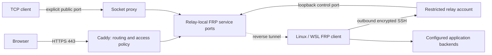

# rbridge

```bash
rbridge publish 3000 --name demo --hostname demo.example.invalid --access public
```

After a one-time setup, that command puts a local app on your own domain over
HTTPS, through a relay you control, with no router port forwarding.

<p align="center">
  
</p>

rbridge runs on modern systemd Linux distributions, including WSL2, and
publishes web applications and TCP services with
[FRP](https://github.com/fatedier/frp). Ansible manages FRP over an
outbound, host-pinned SSH connection; systemd reconnects it. Caddy publishes
HTTPS, with optional Basic authentication or OIDC browser login. The
origin-to-relay transport is direct SSH. Native SSH clients on filtered
networks can use an [explicit SOCKS access profile](docs/operations.md#native-ssh-access-on-filtered-networks).

A self-hosted alternative to Cloudflare Tunnel for publishing web apps and TCP
services—not a replacement for Cloudflare's global network, WAF, CDN, VPN, or
identity platform. You provision, secure, and pay for the relay. Native TCP
clients need no tunnel-specific software.

See the [Cloudflare Tunnel and Tailscale comparison](docs/comparison.md) for
matched measurements of this project, Cloudflare Quick Tunnel, Tailscale private
mesh and public Funnel: throughput, checked HTTPS/SSH transfers, latency, CPU/RSS
and recovery on temporary Hetzner VPSs. Separate matched batches and different
access paths prevent a universal speed ranking.



## Included

- Multiple named TCP and HTTP services, with one validated configuration model.
- Web-first `rbridge` workspace: one-time setup, short publish/remove commands,
  automatic internal ports, redacted discovery, and interruption previews.
- Custom web hostnames, automatic HTTPS certificates/renewals, WebSockets and
  streaming responses; verified HTTPS backends are supported.
- Explicit per-web-app `public`, `application`, `basic`, or `oidc` access policy.
- Optional dedicated key-only SSH service, separate login/relay keys, and a
  forwarding-only relay account. Native host SSH remains separate.
- systemd 247+ roles for Debian/Ubuntu, Fedora/RHEL-family, openSUSE and Arch
  Linux on amd64 and arm64 (SELinux-aware), checksum-pinned FRP, Caddy and
  oauth2-proxy releases, and unprivileged services.
- Configuration validation, layered `doctor` diagnostics, native SSH bulk
  transfer checks using explicit client profiles, and stale service cleanup.
- Private input generation, CI deployment regressions and an optional manual
  GitHub Actions relay deployment. Optional Windows logon startup keeps WSL alive.

All raw FRP service ports and management APIs stay on relay/client loopback.
Only explicit TCP publications and Caddy's web listeners are public. A web
application has no public raw port that could bypass its access policy.

## Install the CLI

From this checkout, on any Linux distribution or WSL:

```bash
sh install.sh
export PATH="$HOME/.local/bin:$PATH"
rbridge --help
```

Add that PATH setting to your shell profile if needed. The installer requires
Python 3.11+ with `venv`/pip support, OpenSSH, `tar`, and Internet access for Python
dependencies. If virtualenv creation fails, install your distribution's venv
support (for example `python3-venv` on Debian/Ubuntu).
No sudo is needed for installation.

The command is installed at `~/.local/bin/rbridge`. Its isolated Python
environment and bundled Ansible playbook/roles live under
`~/.local/share/rbridge`; commands work from any directory without activating a
virtualenv or retaining this checkout. No private inventory, secrets, `.env`,
logs or Git history are copied from the checkout.

For another location/interpreter, use
`sh install.sh --prefix /path/to/prefix --python python3.12`, then add that
prefix's `bin` directory to PATH. Use a Linux filesystem that enforces
permissions: not a Windows drive such as WSL `/mnt/c`, or a FAT/NTFS/SMB mount.

**Update:** obtain the desired project revision and rerun the installer with the
same prefix. Each installation builds a separate release and switches to it only
after dependencies and CLI startup succeed. Failed builds leave the previous
release selected. Old releases are retained; private workspaces are untouched.
Do not move an installed prefix: Python virtualenvs contain absolute paths.

**Uninstall the local CLI:** remove `~/.local/bin/rbridge` and
`~/.local/share/rbridge` (adjust both for a custom prefix). This does not stop
deployed publications, uninstall relay/origin services, or delete private
workspaces; use the [operations guide](docs/operations.md#rotation-and-removal)
for those actions.

## Quick start

Use a Linux/WSL controller with Python 3.11+, OpenSSH and sudo. Both managed hosts
need a [supported systemd distribution](docs/deployment.md#supported-setup); under
WSL, enable systemd first. The web-first workspace uses the current machine as the
origin and needs no login account.

```bash
export PATH="$HOME/.local/bin:$PATH"
export PRIVATE="$HOME/.config/rbridge-private"
```

Obtain the relay's Ed25519 host key through a trusted connection or provider
console and independently verify its fingerprint. Save an unhashed `known_hosts`
entry outside the checkout; `ssh-keyscan` alone does not establish trust.

```bash
rbridge init \
  --relay relay.example.invalid \
  --known-hosts "$HOME/.config/verified-relay-hosts" \
  --admin-key "$HOME/.ssh/relay-admin"
rbridge plan
rbridge apply --ask-become-pass
```

Replace the documentation-only relay hostname. `init` creates private inputs
outside the checkout, on a permission-enforcing Linux filesystem (not WSL
`/mnt/c`), and refuses to overwrite existing keys. It does **not** provision a
VPS or publish a service.
Review the generated inventory before `apply`, which deploys both hosts using
Ansible. Omit `--ask-become-pass` when sudo is passwordless. Administrative SSH is
non-interactive: load an encrypted administrative key into your agent first.

Start your application on port 3000. Point a hostname you control to the relay
and allow inbound relay SSH and TCP 80/443 for HTTPS/ACME. Firewall and DNS remain
administrator-owned; never expose FRP control, relay-local, OIDC or admin ports.

```bash
# Preview only: no service file or host changes.
rbridge publish 3000 --name demo \
  --hostname demo.example.invalid --access public --dry-run

# Deploy by default after displaying interruption impact.
rbridge publish 3000 --name demo \
  --hostname demo.example.invalid --access public --ask-become-pass

rbridge list --show-endpoints
rbridge status --json
```

`public` deliberately permits everyone. Use `--access application` when the app
owns authentication, or `--access-file` for a private Basic/OIDC policy. A new
service requires an explicit policy. Updating a named app preserves its hostname,
access policy and internal port when those options are omitted:

```bash
rbridge publish 3001 --name demo --ask-become-pass
rbridge remove demo --dry-run   # preview removal
rbridge remove demo --ask-become-pass
```

`publish`, `remove`, and `apply` perform a real rollout by default. Add
`--dry-run` for a non-mutating preview: no workspace writes, deployment, or
sudo prompt. `plan` remains read-only; `init` only creates local workspace inputs.

Publication is persistent, not tied to this terminal. Removing the final
publication leaves idle infrastructure, credentials and certificate storage;
full uninstall remains manual. Any manifest/policy change can disconnect
**all** services sharing the transport, including unchanged apps. Failed applies
remain explicitly uncertain until a successful rollout. Plans compare against
the last successful CLI apply, not live host state.

Names/endpoints are hidden by default; `--show-endpoints` explicitly reveals
local connection instructions, never credentials. `list` describes configured
services without probing; `status` checks public ingress from this machine,
not authenticated login or end-to-end application readiness.

See [publishing workspaces](docs/deployment.md#publishing-workspace) for command
contracts, policies and port allocation. [Advanced configuration](docs/deployment.md#private-configuration)
supports multiple TCP services, optional managed SSH and direct Ansible use.
HTTPS terminates at the relay, which can read web traffic.

## Operations and verification

Run diagnostics from a copy of this repository on the installed host:

```bash
sudo python3 scripts/tunnel.py doctor \
  --config "$PRIVATE/services.yml" --role client --json
# Use --role server on the relay. OIDC configs also need --config secrets.yml.
```

Doctor distinguishes transport, registration, backend and public ingress.
A TCP handshake is not an application health check; a Basic challenge or OIDC
redirect does not prove an authenticated login. See [operations](docs/operations.md).
Use `scripts/tunnel.py bulk-check --ssh-config /private/client.conf --host tunnel`
to verify sustained native SSH upload/download from the actual client network.

Under WSL, run from Windows PowerShell after deployment (not needed on other Linux):

```powershell
./scripts/register-wsl-startup.ps1 -Distribution Ubuntu-24.04
```

Startup occurs at user logon, not before logon or during sleep. After deliberate
`wsl --shutdown`, restart the task or open WSL. Network filtering differs by
provider; exercise real payloads from your intended client network.

```bash
python -m unittest discover -s tests -v
ansible-playbook -i ansible/inventory.example.yml ansible/deploy.yml --syntax-check
python scripts/check-privacy.py --history
```

[Contributing](CONTRIBUTING.md) documents the destructive disposable-host field
suite: real FRP/OpenSSH, Caddy TLS, Dex/oauth2-proxy browser login, authorization
failures, transfers, streaming, restart recovery, removal and idempotence.

## Privacy and security

Keep endpoints, accounts, keys, passwords, tokens, inventories and logs outside
this checkout. Read [privacy](docs/privacy.md) and [security](SECURITY.md) before
publishing. Hooks and CI detect common leaks, not every identifier. Install the
hooks:

```bash
git config --local core.hooksPath .githooks
```

Contributors who prefer anonymous Git metadata can commit under the generic
identity checked by `scripts/check-privacy.py --anonymous-history`:

```bash
git config --local user.name 'rbridge contributors'
git config --local user.email 'contributors@example.invalid'
git config --local commit.gpgsign false
```

## Credits

rbridge is a deployment and publishing layer around
[FRP](https://github.com/fatedier/frp), the fast reverse proxy by
[fatedier](https://github.com/fatedier) and its contributors. FRP's `frps` and
`frpc` carry every tunnelled connection; rbridge supplies the SSH transport,
HTTPS ingress, access policies and deployment automation around them.
[Caddy](https://caddyserver.com) and
[oauth2-proxy](https://github.com/oauth2-proxy/oauth2-proxy) provide HTTPS and
browser login.

## License

This project's code is MIT licensed. Downloaded FRP (Apache-2.0), Caddy and
oauth2-proxy binaries retain their upstream licenses and are not committed here.
