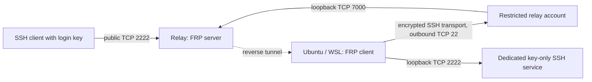

# FRP tunnel

Expose key-only SSH on Ubuntu or Ubuntu WSL2 through a public relay, without
router port forwarding or a system proxy. Deployment is repeatable with Ansible;
systemd maintains the connection and a Windows logon task keeps WSL running.

The default transport carries FRP through a dedicated outbound SSH connection.
This is useful where direct FRP connections establish successfully but stall when
carrying data. Network filtering differs between providers: verify the resulting
tunnel on your own network.



## What is included

- Ubuntu 24.04+ server and Linux/WSL client roles, for amd64 and arm64.
- Pinned FRP releases, verified SHA256 downloads, and unprivileged FRP services.
- A forwarding-only relay account restricted to the FRP control endpoint.
- A separate SSH instance that accepts one configured public key and rejects
  passwords, keyboard-interactive authentication, and root login.
- Automatic reconnection and configurable Windows logon startup.
- Private input generation, commit/push privacy hooks, CI integration tests, and
  an optional manual GitHub Actions relay deployment.

Real endpoints, accounts, keys, tokens, inventories, and logs belong outside this
checkout. The examples contain documentation-only values. The project does not
contain a live deployment's configuration or key material.

## Quick start

Run the deployment controller inside Ubuntu/WSL or another Linux environment with
Python 3.11+, OpenSSH client tools, and sudo. Both managed hosts need Ubuntu 24.04+
with systemd; WSL must already have systemd enabled. The client login account must
exist and the chosen backend port must be free.

```bash
python3 -m venv .venv
. .venv/bin/activate
python -m pip install -r requirements-dev.txt
export ANSIBLE_CONFIG="$PWD/ansible/ansible.cfg"
export PRIVATE="$HOME/.config/frp-tunnel-private"
```

Obtain the relay's Ed25519 SSH host key through a trusted existing connection or
provider console, verify its fingerprint independently, and save an unhashed
`known_hosts` entry outside the checkout. A network `ssh-keyscan` result alone
does not establish trust. For a non-default relay SSH port, the entry must use
`[host]:port`.

Generate fresh, separate relay and login keys plus a random FRP token. Use a Linux
filesystem for the output, not a WSL shared `/mnt` directory:

```bash
python scripts/create-secrets.py \
  --output "$PRIVATE" \
  --server-host relay.example.invalid \
  --client-user developer \
  --known-hosts "$HOME/.config/verified-relay-hosts"
```

Replace the documentation-only hostname and username with your own private
inputs. The generator refuses existing directories and Git checkouts; it writes
mode-600 files in a mode-700 directory. `login_id_ed25519` is the key used to access
the client; the distinct relay key is only for automatic forwarding. You can
instead supply an existing Ed25519 login public key in `secrets.yml`, keeping its
private half outside the repository.

Review the generated inventory privately. Set the relay administration account,
ports, and any Ansible privilege escalation settings you need. Then deploy the
server and client separately:

```bash
export ANSIBLE_SSH_ARGS="-F /dev/null -o StrictHostKeyChecking=yes -o UserKnownHostsFile=$PRIVATE/known_hosts -o ForwardAgent=no -o ProxyCommand=none -o ProxyJump=none"
ansible-playbook -i "$PRIVATE/inventory.yml" -e "@$PRIVATE/secrets.yml" \
  --private-key "$HOME/.ssh/relay-admin" --limit frp_servers ansible/deploy.yml
ansible-playbook -i "$PRIVATE/inventory.yml" -e "@$PRIVATE/secrets.yml" \
  --ask-become-pass --limit frp_clients ansible/deploy.yml
```

Allow inbound TCP on the relay's existing SSH port and the chosen public tunnel
port. The FRP control port stays on loopback and must not be opened in a firewall.
The roles leave firewall policy to the administrator and add an SSH policy scoped
to the dedicated relay account. See [deployment prerequisites](docs/deployment.md) for relay
SSH policy, upgrades, and coexistence with an existing tunnel.

From a machine holding the login key:

```bash
ssh -p 2222 -i "$PRIVATE/login_id_ed25519" developer@relay.example.invalid
```

Verify the client SSH host fingerprint through a trusted client session before
accepting it on first login. The relay's SSH host key and the tunneled client's
SSH host key are different identities.

For WSL, register startup from Windows PowerShell after deploying the client:

```powershell
./scripts/register-wsl-startup.ps1 -Distribution Ubuntu-24.04
```

This starts at Windows user logon, not before logon or while the computer sleeps.
Systemd services alone do not keep a WSL distribution alive. After a deliberate
`wsl --shutdown`, restart the task or open WSL; a manual shutdown can end the
keepalive process normally. [Operations](docs/operations.md) covers service and
task control.

## Validation and deployment workflows

```bash
python -m unittest discover -s tests -v
ansible-playbook -i ansible/inventory.example.yml ansible/deploy.yml --syntax-check
python scripts/check-privacy.py --history
```

CI runs these checks, parses the PowerShell startup script, and provisions an
ephemeral Ubuntu runner with the real Ansible roles. Integration tests verify
key-only login, 1 MiB transfers in both directions, relay restrictions, recovery
after restarting the transport, and a second deployment with no changes.

The **Deploy relay** workflow is manual, restricted to `main`, and uses the
`production` environment. Configure its private inputs and environment controls
as described in [GitHub Actions deployment](docs/deployment.md#github-actions).
Deploy the WSL client locally; a hosted runner cannot reach a private local WSL
instance.

## Privacy, security, and contributions

Before publishing, read [the privacy checklist](docs/privacy.md). Install local
hooks and use a generic commit identity if you want anonymous commit metadata:

```bash
git config --local core.hooksPath .githooks
git config --local user.name 'FRP Tunnel contributors'
git config --local user.email 'contributors@example.invalid'
git config --local commit.gpgsign false
```

Hooks and CI catch common key material, tokens, deployment IPs, personal paths,
and email addresses. They cannot prove that arbitrary prose, hostnames, logs, or
Git metadata contain no identifying information. Review the staged diff and
history before publication. See [CONTRIBUTING](CONTRIBUTING.md) and
[SECURITY](SECURITY.md).

This project's code is MIT licensed. Downloaded FRP binaries remain under
[FRP's Apache-2.0 license](https://github.com/fatedier/frp/blob/dev/LICENSE);
they are downloaded during deployment and are not committed here.
