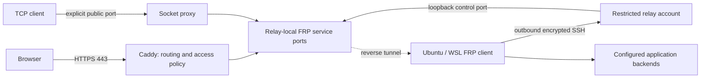

# FRP tunnel

Publish web applications and TCP services from Ubuntu or Ubuntu WSL2 through a
relay you control, without router port forwarding. Ansible
manages FRP over an outbound, host-pinned SSH connection; systemd reconnects it.
Caddy publishes HTTPS, with optional Basic authentication or OIDC browser login.
The origin-to-relay transport is direct SSH. Native SSH clients on filtered
networks can use an [explicit SOCKS access profile](docs/operations.md#native-ssh-access-on-filtered-networks).

A self-hosted alternative to Cloudflare Tunnel for publishing web apps and TCP
services—not a replacement for Cloudflare's global network, WAF, CDN, VPN, or
identity platform. You provision, secure, and pay for the relay. Native TCP
clients need no tunnel-specific software.

See the [Cloudflare Tunnel and Tailscale comparison](docs/comparison.md) for
source-linked product limits, published benchmarks, and measured throughput,
latency, resource use and recovery on a temporary Hetzner deployment. The results
distinguish access paths and are not a controlled three-product speed ranking.

The [`v0.1` release](https://github.com/0xprincess/frp-tunnel/releases/tag/v0.1)
preserves the complete SSH-only baseline. Generalized publishing is developed on
`dev`; [deployment](docs/deployment.md) describes migration and rollback.



## Included

- Multiple named TCP and HTTP services, with one validated configuration model.
- Custom web hostnames, automatic HTTPS certificates/renewals, WebSockets and
  streaming responses; verified HTTPS backends are supported.
- Explicit per-web-app `public`, `application`, `basic`, or `oidc` access policy.
- Optional dedicated key-only SSH service, separate login/relay keys, and a
  forwarding-only relay account. Native host SSH remains separate.
- Ubuntu 24.04+ / systemd roles for amd64 and arm64, checksum-pinned FRP, Caddy
  and oauth2-proxy releases, and unprivileged services.
- Configuration validation, layered `doctor` diagnostics, native SSH bulk
  transfer checks using explicit client profiles, and stale service cleanup.
- Private input generation, CI deployment regressions and an optional manual
  GitHub Actions relay deployment. Windows logon startup can keep WSL alive.

All raw FRP service ports and management APIs stay on relay/client loopback.
Only explicit TCP publications and Caddy's web listeners are public. A web
application has no public raw port that could bypass its access policy.

## Quick start

Use a Linux/WSL controller with Python 3.11+, OpenSSH and sudo. Both managed hosts
need Ubuntu 24.04+ with systemd; enable systemd in WSL first. The default SSH
preset requires an existing non-root client login account.

```bash
python3 -m venv .venv
. .venv/bin/activate
python -m pip install -r requirements-dev.txt
export ANSIBLE_CONFIG="$PWD/ansible/ansible.cfg"
export PRIVATE="$HOME/.config/frp-tunnel-private"
```

Obtain the relay's Ed25519 host key through a trusted connection or provider
console and independently verify its fingerprint. Save an unhashed `known_hosts`
entry outside the checkout; `ssh-keyscan` alone does not establish trust.

```bash
python scripts/create-secrets.py \
  --output "$PRIVATE" \
  --server-host relay.example.invalid \
  --client-user developer \
  --known-hosts "$HOME/.config/verified-relay-hosts"
```

Replace the documentation-only hostname and account. The generator refuses
existing directories and Git checkouts; use a Linux filesystem, not WSL `/mnt`.
It creates private `inventory.yml`, editable `services.yml`, `secrets.yml`, and
separate relay/login keys. Review inventory administration and sudo settings.

The generated `services.yml` contains the SSH preset. Add services there, for
example:

```yaml
frp_server_address: relay.example.invalid
frp_managed_ssh: true
frp_services:
  - name: ssh
    protocol: tcp
    backend: 127.0.0.1:2222
    relay_port: 12222
    public_port: 2222
  - name: website
    protocol: http
    hostname: www.example.invalid
    backend: http://127.0.0.1:3000
    relay_port: 12300
    access:
      mode: public
```

`relay_port` is private to the relay. Public TCP ports must be explicit, distinct
from all relay-local listeners, and at least 1024. HTTP services require a
hostname and explicit access policy. `public` intentionally permits everyone;
use [access policies](docs/deployment.md#web-access-policies) for private tools.
For web-only installations, use `--services-file` with your configuration and
`--no-managed-ssh`; no client login account/key is then required.

```bash
python scripts/tunnel.py validate \
  --config "$PRIVATE/services.yml" --config "$PRIVATE/secrets.yml"
export ANSIBLE_SSH_ARGS="-F /dev/null -o StrictHostKeyChecking=yes -o UserKnownHostsFile=$PRIVATE/known_hosts -o ForwardAgent=no -o ProxyCommand=none -o ProxyJump=none"
ansible-playbook -i "$PRIVATE/inventory.yml" \
  -e "@$PRIVATE/services.yml" -e "@$PRIVATE/secrets.yml" \
  --private-key "$HOME/.ssh/relay-admin" --limit frp_servers ansible/deploy.yml
ansible-playbook -i "$PRIVATE/inventory.yml" \
  -e "@$PRIVATE/services.yml" -e "@$PRIVATE/secrets.yml" \
  --ask-become-pass --limit frp_clients ansible/deploy.yml
```

Allow relay inbound SSH, chosen public TCP ports, and TCP 80/443 for web
publishing. Point each web hostname's DNS to the relay; automatic public
certificates require reachable ACME challenges. Do not open FRP control, relay
service, OIDC or admin API ports. Firewall policy remains administrator-owned.

```bash
ssh -p 2222 -i "$PRIVATE/login_id_ed25519" developer@relay.example.invalid
```

Verify the tunneled client's SSH fingerprint independently before first login;
it is not the relay's fingerprint. Web clients use `https://` and the configured
hostname. HTTPS terminates at the relay, which can read web traffic.

## Operations and verification

Run diagnostics from a copy of this repository on the installed host:

```bash
sudo python3 scripts/tunnel.py doctor \
  --config "$PRIVATE/services.yml" --role client --json
# Use --role server on the relay. OIDC configs also need --config secrets.yml.
```

Doctor distinguishes transport, registration, backend and public ingress.
A TCP handshake is not an application health check; a Basic challenge or OIDC
redirect does not prove an authenticated login. See [operations](docs/operations.md).
Use `scripts/tunnel.py bulk-check --ssh-config /private/client.conf --host tunnel`
to verify sustained native SSH upload/download from the actual client network.

For WSL, run from Windows PowerShell after deployment:

```powershell
./scripts/register-wsl-startup.ps1 -Distribution Ubuntu-24.04
```

Startup occurs at user logon, not before logon or during sleep. After deliberate
`wsl --shutdown`, restart the task or open WSL. Network filtering differs by
provider; exercise real payloads from your intended client network.

```bash
python -m unittest discover -s tests -v
ansible-playbook -i ansible/inventory.example.yml ansible/deploy.yml --syntax-check
python scripts/check-privacy.py --history
```

[Contributing](CONTRIBUTING.md) documents the destructive disposable-host field
suite: real FRP/OpenSSH, Caddy TLS, Dex/oauth2-proxy browser login, authorization
failures, transfers, streaming, restart recovery, removal and idempotence.

## Privacy and security

Keep endpoints, accounts, keys, passwords, tokens, inventories and logs outside
this checkout. Read [privacy](docs/privacy.md) and [security](SECURITY.md) before
publishing. Hooks and CI detect common leaks, not every identifier. Install hooks
and a generic identity if anonymous Git metadata is desired:

```bash
git config --local core.hooksPath .githooks
git config --local user.name 'FRP Tunnel contributors'
git config --local user.email 'contributors@example.invalid'
git config --local commit.gpgsign false
```

This project's code is MIT licensed. Downloaded FRP, Caddy and oauth2-proxy
binaries retain their upstream licenses and are not committed here.
